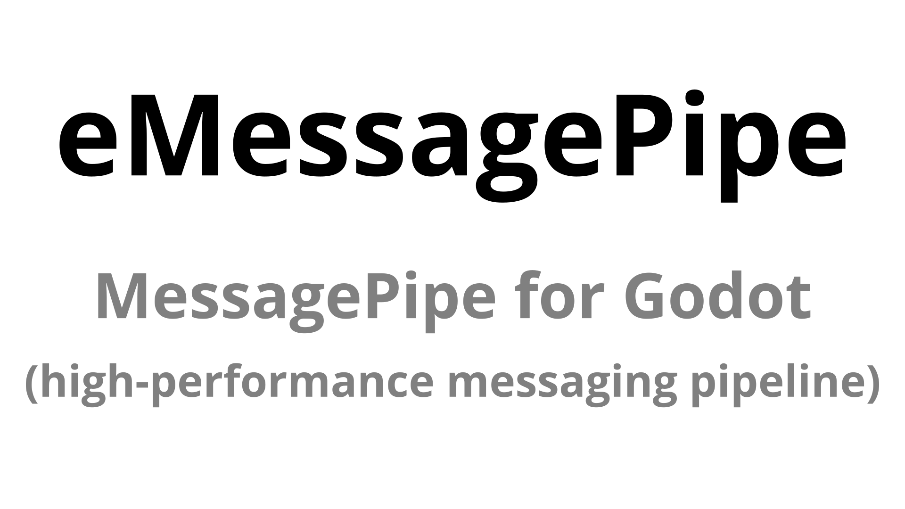

<div align="center">



# eMessagePipe

**[MessagePipe](https://github.com/Cysharp/MessagePipe) support for [Godot](https://godotengine.org/) .NET projects,
with an optional integration for [eContainer](https://github.com/enaweg/godot-econtainer).**

[](https://github.com/enaweg/godot-emessagepipe/actions/workflows/ci-pr.yml)


**NOTE**: This project is experimental and still a work in progress.

</div>

## Overview

[MessagePipe](https://github.com/Cysharp/MessagePipe) is Cysharp's high-performance in-memory/distributed messaging
library for .NET and Unity. Instead of wiring senders directly to receivers (or to Godot signals), a component asks the
DI container for a typed publisher or subscriber and talks to a *message type*. Publisher and subscriber never learn
about each other, which keeps scenes, services and systems decoupled and independently testable.

### What eMessagePipe adds

+ **eContainer integration (optional)** — when [eContainer](https://github.com/enaweg/godot-econtainer) is enabled,
  MessagePipe's `IServiceCollection` registration is connected to VContainer's `IContainerBuilder`, so `IPublisher<T>`
  and `ISubscriber<T>` resolve from the same `LifetimeScope` as the rest of your registrations. There is no separate
  service provider that must be kept in sync with the scene tree.
+ **Godot helpers** that work with or without eContainer: subscriptions disposed with their node, and filters that run
  handlers on Godot's main thread.
+ **Self-installing packages** — ePlugin Framework adds the `MessagePipe` and `MessagePipe.Analyzer` NuGet packages
  (MessagePipe 1.8.2) to your project.
+ **Updates** from GitHub releases through the ePlugin Manager.

Without eContainer, eMessagePipe installs the MessagePipe packages and its Godot helpers only, and you can use
MessagePipe with another dependency injection setup (see [Without eContainer](#without-econtainer)).

### MessagePipe features

+ **Typed publish/subscribe** — `IPublisher<TMessage>` / `ISubscriber<TMessage>` replace events and signal strings with
  a message type. Subscribing returns an `IDisposable`; `DisposableBag` bundles many subscriptions into one dispose
  call, and eMessagePipe's `AddTo(node)` disposes a subscription when its node is freed (see
  [Godot helpers](#godot-helpers)).
+ **Keyed (topic) brokers** — `IPublisher<TKey, TMessage>` / `ISubscriber<TKey, TMessage>` route the same message type
  by key, so one broker can serve many entities, channels or states.
+ **Async publish/subscribe** — `IAsyncPublisher<TMessage>` / `IAsyncSubscriber<TMessage>` await every handler.
  `MessagePipeOptions.DefaultAsyncPublishStrategy` selects `Parallel` or `Sequential` handler execution, and
  `PublishAsync` accepts a `CancellationToken`.
+ **Buffered brokers** — `IBufferedPublisher<TMessage>` / `IBufferedSubscriber<TMessage>` retain the most recent message
  and replay it to new subscribers, which suits state-like values (current health, current game phase) where a late
  subscriber still needs the last known value.
+ **Request/response handlers** — `IRequestHandler<TRequest, TResponse>` and its async counterpart give a mediator-style
  one-to-one call; `IRequestAllHandler<TRequest, TResponse>` fans the request out to every registered handler and
  collects the responses.
+ **Filters** — `MessageHandlerFilter<T>` and `RequestHandlerFilter<TRequest, TResponse>`, with their async
  variants, form an ordered middleware pipeline around handlers, for cross-cutting concerns such as logging, validation,
  predicate-based filtering or de-duplication. Filters are themselves resolved from the container and can be attached
  globally, per subscription, or by attribute.
+ **Performance-oriented design** — handler invocation goes through array-based broker cores rather than reflection or
  delegate chains, keeping publish paths allocation-light; MessagePipe's own README states it is faster than standard
  C# events and 78 times faster than Prism's `EventAggregator`.
+ **Diagnostics** — `MessagePipeDiagnosticsInfo` reports live subscription counts, and
  `MessagePipeOptions.EnableCaptureStackTrace` records where each subscription was created, which makes leaked
  subscriptions findable.
+ **`MessagePipe.Analyzer`** — a Roslyn analyzer, installed alongside the library, whose `MPA001` diagnostic reports a
  discarded `IDisposable` from `Subscribe` — the most common source of subscription leaks.

MessagePipe's distributed transports (Redis, in-process, WebSocket, gRPC/MagicOnion) ship as separate packages that
eMessagePipe does not install.

## Requirements

The current CI-tested configuration uses:

+ [Godot 4.7.2 .NET](https://godotengine.org/download/archive/4.7.2-stable/)
+ [.NET 8 SDK](https://dotnet.microsoft.com/download/dotnet/8.0)
+ [ePlugin Framework](https://github.com/enaweg/godot-epluginframework) 0.7.0, the version included in this repository
  (0.9.0 or newer adds updates through the ePlugin Manager)
+ [eContainer](https://github.com/enaweg/godot-econtainer) (optional; required for the VContainer integration)

eMessagePipe's sources compile into your Godot project, so your project's target framework applies. The project in
this repository targets `net8.0`, and `net9.0` for Android exports.

## Installation

1. Install and enable [ePlugin Framework](https://github.com/enaweg/godot-epluginframework) in your Godot .NET project.
   Install and enable [eContainer](https://github.com/enaweg/godot-econtainer) as well if you want its VContainer
   integration.
2. Download the latest eMessagePipe [release](https://github.com/enaweg/godot-emessagepipe/releases) and extract the
   archive's `addons/eMessagePipe` directory into your Godot project's `addons` directory. To install from a clone of
   this repository instead, see [Installing from a clone](#installing-from-a-clone).
3. Open the project in the Godot .NET editor and enable **eMessagePipe** under **Project > Project Settings > Plugins**.
4. Let ePlugin complete the package installation and project reload.

The plugin adds the `MessagePipe` and `MessagePipe.Analyzer` NuGet packages to the Godot C# project. No manual
`dotnet add package` command is needed.

ePlugin keeps a directory out of the build by prefixing its name with a dot. A release therefore ships the plugin's
sources hidden, as `.src` (the Godot helpers) and `.src-econtainer` (the eContainer integration). Enabling eMessagePipe
makes `.src` available, and ePlugin makes `.src-econtainer` available while eContainer is enabled. eContainer can be
enabled before or after eMessagePipe; the integration source is added and removed as it changes state.

Commit the `addons/eplugin-state.json` file ePlugin writes along with your addons, but not
`addons/eplugin-state.json.user`: the first records the installed plugin versions for the whole team, the second holds
unfinished or failed work on one machine.

The repository also contains a sample project in `src/emessagepipe`.

### Installing from a clone

Copy `src/emessagepipe/addons/eMessagePipe` into your project's `addons` directory and rename its `src` directory to
`.src` and its `src-econtainer` directory to `.src-econtainer` before opening the project in Godot. This is the same
layout the release workflow produces.

## Updates

eMessagePipe declares its [releases](https://github.com/enaweg/godot-emessagepipe/releases) as its update source in
`plugin.cfg`, along with links to this documentation and its source code. With
[ePlugin](https://github.com/enaweg/godot-epluginframework) 0.9.0 or newer, the **ePlugin Manager** (the ePlugin button
on the main toolbar, or **Project > Tools > ePlugin Manager...**) shows these links in the plugin's details, checks for
new eMessagePipe versions, installs them with a backup and rollback, and offers older versions as well. ePlugin updates
itself the same way. See
[Updating plugins](https://github.com/enaweg/godot-epluginframework/blob/main/docs/updating-plugins.md) for details.

### Upgrading from older releases

+ Releases before v0.3.0 predate the optional integration and still require eContainer.
+ Releases up to v0.3.1 do not declare an update source yet. To update such an installation through the ePlugin
  Manager, add `https://github.com/enaweg/godot-emessagepipe/releases` for eMessagePipe under **Update sites...**
  (see [Project update sites](https://github.com/enaweg/godot-epluginframework/blob/main/docs/updating-plugins.md#project-update-sites)),
  or replace `addons/eMessagePipe` with a newer release once by hand.

## Usage

### Registering MessagePipe

Register MessagePipe in an eContainer `LifetimeScope`. Publishers and subscribers then resolve for any message type in
that scope and its child scopes, without registering message types one by one:

```C#
using Enaweg.Container.Godot;
using Enaweg.MessagePipe;
using VContainer;

public sealed class PlayerDied { }

public partial class GameLifetimeScope : LifetimeScope
{
    protected override void Configure(IContainerBuilder builder)
    {
        builder.RegisterMessagePipe();
    }
}
```

`RegisterMessagePipe` runs MessagePipe's own `AddMessagePipe`, so its open-generic publishers, subscribers and
request-handler entry points resolve for every message type.

+ **Call it once**, in the outermost `LifetimeScope` that uses MessagePipe, and pass the `MessagePipeOptions` it
  returns to the other registrations in that scope or its child scopes. A second call in the same scope or in a child
  scope throws: the child would otherwise get its own brokers for every message type and stop receiving its parent's
  messages.
+ **Configure the options** through `RegisterMessagePipe(options => ...)`. Global filters added there, such as
  `options.AddGlobalMessageHandlerFilter<...>()`, are registered as well. Broker registrations use
  `options.InstanceLifetime`; request handlers use `options.RequestHandlerLifetime`.
+ **Auto-registration**, MessagePipe's assembly scanning, is off by default; set `options.EnableAutoRegistration = true`
  to opt in.

### Publishing and subscribing

Resolve or inject `IPublisher<TMessage>` and `ISubscriber<TMessage>` from the same VContainer scope:

```C#
using MessagePipe;

public sealed class ScoreService
{
    private readonly IPublisher<PlayerDied> playerDied;

    public ScoreService(IPublisher<PlayerDied> playerDied)
    {
        this.playerDied = playerDied;
    }

    public void OnPlayerDied()
    {
        playerDied.Publish(new PlayerDied());
    }
}
```

Subscriptions are disposable. Keep the returned `IDisposable` for as long as the receiver needs messages, and dispose
it when the receiver leaves its scope:

```C#
using System;
using MessagePipe;

public sealed class PlayerDeathListener : IDisposable
{
    private readonly IDisposable subscription;

    public PlayerDeathListener(ISubscriber<PlayerDied> playerDied)
    {
        subscription = playerDied.Subscribe(_ => Console.WriteLine("Player died"));
    }

    public void Dispose() => subscription.Dispose();
}
```

### Subscribing from a node

Nodes receive their subscribers through an `[Inject]` method, which eContainer calls when it injects the node: add the
node to the scope's **Auto Inject Nodes** in the inspector, or create it with
`scope.Container.Instantiate<Hud>(hudScene, parent)`.

```C#
using Enaweg.MessagePipe;
using Godot;
using MessagePipe;
using VContainer;

public partial class Hud : Control
{
    [Inject]
    public void Construct(ISubscriber<PlayerDied> playerDied)
    {
        playerDied
            .Subscribe(_ => Visible = false, new MainThreadMessageHandlerFilter<PlayerDied> { Owner = this })
            .AddTo(this);
    }
}
```

`AddTo(this)` ends the subscription when the node is freed, and the filter runs the handler on the main thread even
when `PlayerDied` is published from a worker thread. Both are described under [Godot helpers](#godot-helpers).

### Godot helpers

These helpers live in the plugin's `src` directory and do not depend on eContainer.

`AddTo(node)` disposes a subscription, or any other `IDisposable`, when the node is freed. It follows the node's
lifetime rather than its tree membership, so reparenting keeps the subscription alive. Calling it while the node is
busy setting up its children, such as from a child's `_Ready`, works too: the subscription is then attached at the end
of the frame, and is still disposed if the node is freed before that:

```C#
using Enaweg.MessagePipe;
using Godot;
using MessagePipe;

public partial class GameOverScreen : Control
{
    public override void _Ready()
    {
        // GlobalMessagePipe needs a provider, see RegisterGlobalMessagePipe or "Without eContainer"
        GlobalMessagePipe.GetSubscriber<PlayerDied>()
            .Subscribe(_ => Show())
            .AddTo(this);
    }
}
```

`MainThreadMessageHandlerFilter<T>` and `MainThreadAsyncMessageHandlerFilter<T>` run handlers on Godot's main thread,
so a message published from a worker thread can still touch nodes. On the main thread the handler runs immediately;
from elsewhere it is deferred to the end of the frame, and the async variant completes once the handler has finished
(cancelling its token while it waits for the main thread cancels it right away). A deferred message can still arrive
after the subscribing node was freed, so set `Owner` to that node to skip the handler then. Use them per subscription
or, with eContainer, for every message type:

```C#
// one subscription
playerDied.Subscribe(OnPlayerDied, new MainThreadMessageHandlerFilter<PlayerDied> { Owner = this }).AddTo(this);

// every message type in the scope
var options = builder.RegisterMessagePipe(o =>
{
    o.AddGlobalMessageHandlerFilter(typeof(MainThreadMessageHandlerFilter<>));
    o.AddGlobalAsyncMessageHandlerFilter(typeof(MainThreadAsyncMessageHandlerFilter<>));
});
```

### Giving a scope its own broker

`RegisterMessageBroker<TMessage>(options)` registers the following closed message-type services in the calling scope,
so a child scope that calls it gets its own broker instead of sharing its parent's:

+ `IPublisher<TMessage>` and `ISubscriber<TMessage>`
+ `IAsyncPublisher<TMessage>` and `IAsyncSubscriber<TMessage>`
+ `IBufferedPublisher<TMessage>` and `IBufferedSubscriber<TMessage>`
+ `IBufferedAsyncPublisher<TMessage>` and `IBufferedAsyncSubscriber<TMessage>`

The keyed `RegisterMessageBroker<TKey, TMessage>(options)` overload registers keyed synchronous and asynchronous
publishers and subscribers.

A child scope takes the options from its parent's container:

```C#
using Enaweg.Container.Godot;
using Enaweg.MessagePipe;
using MessagePipe;
using VContainer;

public sealed class EnemyHit { }

public partial class LevelLifetimeScope : LifetimeScope
{
    protected override void Configure(IContainerBuilder builder)
    {
        var options = Parent.Container.Resolve<MessagePipeOptions>();

        // this level gets its own PlayerDied broker; other message types still reach the parent's
        builder.RegisterMessageBroker<PlayerDied>(options);

        // keyed by enemy id
        builder.RegisterMessageBroker<int, EnemyHit>(options);
    }
}
```

### Request handlers and filters

`RegisterRequestHandler<TRequest, TResponse, THandler>(options)` and
`RegisterAsyncRequestHandler<TRequest, TResponse, THandler>(options)` register a handler together with the
`IRequestHandler` and `IRequestAllHandler` entry points (or their async counterparts); register several handlers for one
request type to use `IRequestAllHandler`. The handler has to implement the handler interface for exactly
`TRequest` and `TResponse`, otherwise the registration does not compile:

```C#
using MessagePipe;

public sealed class GetScore { }

public sealed class ScoreHandler : IRequestHandler<GetScore, int>
{
    public int Invoke(GetScore request) => 42;
}

// in Configure
var options = builder.RegisterMessagePipe();
builder.RegisterRequestHandler<GetScore, int, ScoreHandler>(options);

// wherever IRequestHandler<GetScore, int> is injected
int score = getScore.Invoke(new GetScore());
```

`RegisterMessageHandlerFilter<T>`, `RegisterAsyncMessageHandlerFilter<T>`, `RegisterRequestHandlerFilter<T>` and
`RegisterAsyncRequestHandlerFilter<T>` register filters.

### GlobalMessagePipe and Microsoft DI extensions

Call `RegisterGlobalMessagePipe()` only from the root scope if you use `GlobalMessagePipe` or its diagnostics window: it
sets MessagePipe's process-wide provider when the scope is built. Calling it while another such scope is still alive
throws. MessagePipe cannot clear its provider, so once the scope is disposed `GlobalMessagePipe` throws an
`InvalidOperationException` until another scope calls `RegisterGlobalMessagePipe()`.

```C#
protected override void Configure(IContainerBuilder builder)
{
    builder.RegisterMessagePipe();
    builder.RegisterGlobalMessagePipe();
}
```

For MessagePipe registration extensions written for Microsoft DI, `builder.AsServiceCollection()` forwards service
descriptors to VContainer and `builder.ToMessagePipeBuilder()` exposes MessagePipe's builder API. The service-collection
bridge cannot remove a registration once forwarded, so `Remove`, `RemoveAt` and `Clear` are unsupported.

### Without eContainer

MessagePipe only brings the dependency injection *abstractions*. To use it without eContainer, add the
`Microsoft.Extensions.DependencyInjection` package to your project (a version matching your target framework, such as
8.x for `net8.0`) and build a provider yourself, for example in an autoload:

```C#
using Godot;
using MessagePipe;
using Microsoft.Extensions.DependencyInjection;

public partial class Messaging : Node
{
    public override void _EnterTree()
    {
        var services = new ServiceCollection();
        services.AddMessagePipe();
        GlobalMessagePipe.SetProvider(services.BuildServiceProvider());
    }
}
```

Nodes can then subscribe through `GlobalMessagePipe.GetSubscriber<TMessage>()` and use the
[Godot helpers](#godot-helpers) as shown above.

## Development and testing

This project needs more testing to move forward. Feel free to participate and provide feedback.

CI builds and tests every pull request and every push to `main` with Godot 4.7.2 and .NET 8, with eContainer enabled.
It also builds the project once with eContainer, the integration source and its tests removed, to check that the Godot
helpers do not depend on eContainer.

Tested combinations:

+ Godot 4.7.2 + .NET 8 SDK (CI)
+ Godot 4.7.2 + .NET 10 SDK (tested locally)

To build and run the tests locally:

```bash
cd src/emessagepipe
export GODOT_BIN="$(command -v godot)" # point this to your Godot .NET executable
dotnet restore eMessagePipe.sln
dotnet build eMessagePipe.sln --configuration Debug --no-restore
"$GODOT_BIN" --path . --editor --headless --quit-after 2000
dotnet test eMessagePipe.sln --configuration Debug --no-build --settings .runsettings
```

Godot must be available when running the tests.
See the [build and test workflow](https://github.com/enaweg/godot-emessagepipe/blob/main/.github/workflows/build-test.yml)
for the complete headless test setup, including `xvfb-run` for the test step on Linux.

[gdUnit4](https://github.com/MikeSchulze/gdUnit4) is used as the test framework. Tests under `test/econtainer` need
eContainer; the others only need Godot.

## Related projects

+ [godot-epluginframework](https://github.com/enaweg/godot-epluginframework)
+ [godot-econtainer](https://github.com/enaweg/godot-econtainer)
+ [godot-elogger](https://github.com/enaweg/godot-elogger)

## Contribute

Feel free to contribute with documentation, testing, or pull requests.

## Commercial Support

Commercial services are available from [Enaweg](https://www.enaweg.at). If you need consulting, implementation
assistance, or tailored development services, please get in touch through their website.

## License

Licensed under the [MIT license](LICENSE).
